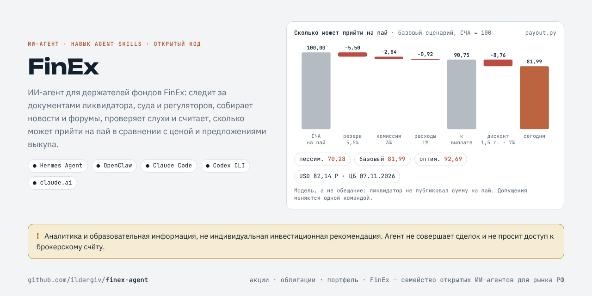
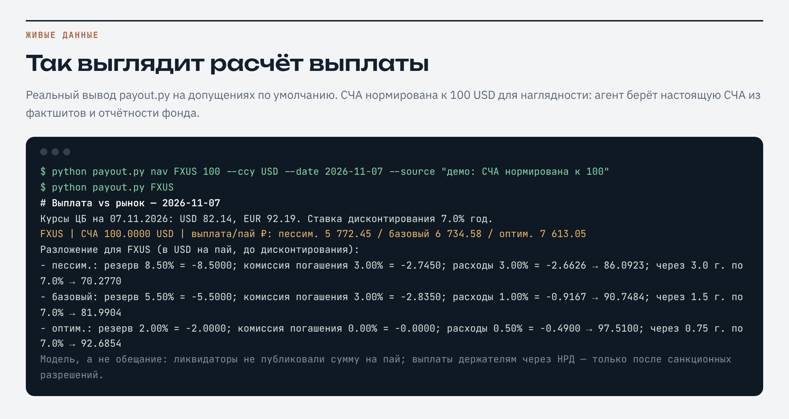

# FinEx — ИИ-агент для пайщиков фондов FinEx в ликвидации

[](LICENSE)       [](https://github.com/ildargiv/finex-agent/actions/workflows/ci.yml) [](https://github.com/ildargiv/finex-agent/releases)

**Открытый ИИ-агент для держателей фондов FinEx** (FXUS, FXGD, FXCN, FXIT и др.) для Hermes Agent, OpenClaw, Claude Code и Codex CLI: документы ликвидатора Teneo и суда, новости, форумы и Telegram с проверкой, модель выплаты на пай против рыночной цены и предложений выкупа, база знаний в Obsidian.

[Презентация агента](https://ildargiv.github.io/finex-agent/?utm_source=github&utm_medium=readme&utm_campaign=finex-agent) · [English](#english) · [База знаний в Obsidian](#база-знаний-в-obsidian) · [Семейство агентов](#семейство-агентов) · [Установка](#установка)



**Коротко о деле** (на 07.11.2026, подробнее — [case-facts.md](skills/finance/finex-liquidation/references/case-facts.md)):
фонды — ирландские ICAV (FinEx Funds ICAV и FinEx Physically Backed Funds ICAV, не Швейцария); 29.06.2026
High Court of Ireland назначил ликвидаторами Teneo; деньги — у Teneo Asset Solutions; держателям через НРД
выплат нет до санкционных разрешений (ЦБ Ирландии, Рег. ЕС 269/2014); удержано ~5,5% на расходы; сроков нет.

## Что умеет
| | |
|---|---|
| Портфель | Импорт ISIN и количеств из отчёта депозитария/брокера (.ods/.xlsx/.csv) или ручной ввод. Хранится только у вас |
| Документы | Следит за finexetf.com, страницами ликвидатора, ЦБ Ирландии, Мосбиржи, НРД; скачивает новые PDF, извлекает текст, агент читает и пересказывает |
| Новости | Google News (RU/EN) по ликвидации FinEx, пометка ⚑ существенного |
| Форумы | Smart-Lab, публичные Telegram-каналы; закрытые группы — через «входящие» |
| Входящие | Сообщения из групп, письма брокеров, предложения выкупа, файлы — сохраняются дословно со статусом проверки |
| База знаний | Хранилище — Obsidian-вики: заметка на фонд, конспект на каждый документ, тема дела с подтверждёнными фактами, журнал знаний, проверка на противоречия, недельный дайджест |
| Выплата vs рынок | СЧА на пай → резерв, комиссия, расходы, замороженные активы → дисконт за срок → ₽ по курсу ЦБ; 3 сценария; сравнение с выкупом; итог по портфелю |

## Установка
Windows (Hermes в `%LOCALAPPDATA%\hermes`):
```powershell
git clone https://github.com/ildargiv/finex-agent; cd finex-agent
powershell -ExecutionPolicy Bypass -File install.ps1 hermes     # или claude / codex / openclaw
```
Linux/macOS/Git Bash:
```bash
./install.sh            # Hermes, профиль finex (`finex chat`)
./install.sh claude     # Claude Code: навык + субагент finex
```
Нужен Python 3.9+ (в Windows подойдёт `py`) и `pypdf` для чтения PDF (ставится установщиком).

## Первый запуск
Скажите агенту: «Вот мой отчёт депозитария, загрузи портфель» (или «у меня FXUS 100 шт., FXGD 50 шт.»),
затем «что нового по FinEx» и «сколько я получу». Сообщения из Telegram-групп просто пересылайте:
«сохрани и проверь: …».

Вручную:
```bash
S=skills/finance/finex-liquidation/scripts
py $S/portfolio.py import "отчёт.ods" --dry-run
py $S/status.py --run
py $S/payout.py
py $S/wiki.py init     # база знаний Obsidian
py $S/wiki.py lint     # проверка: непрочитанные документы, СЧА без источника, противоречия
```



## Приватность
Портфель, количества, отчёты и переписка хранятся только в `~/finex-desk` (переменная `FINEX_DESK`) на вашем
компьютере. В репозиторий и в поисковые запросы они не попадают.

## База знаний в Obsidian
Хранилище агента — это готовая **LLM-вики в формате Obsidian**: markdown-заметки со ссылками `[[...]]` и свойствами (YAML-frontmatter), которые агент пишет и читает сам. Откройте папку `~/finex-desk` в Obsidian («Открыть папку как хранилище») и увидите граф связей, обратные ссылки и свойства.

- **Заметка на каждый фонд** — `funds/FXUS.md`: СЧА с источником, котировки и предложения выкупа, документы, где упомянут фонд.
- **Тема дела** — `topics/Ликвидация FinEx.md`: подтверждённые факты со ссылками на документы.
- **Документы ликвидаторов, суда, регуляторов — вложения**, рядом заметка-конспект `docs/<имя>.md`: что решено, сроки, суммы, что требуется от пайщика.
- **`log.md` — журнал знаний**: что агент узнал, вывел или исправил, с источником. **`index.md`** собирается автоматически.
- **Проверка вики** (`wiki.py lint`): непрочитанные и незаконспектированные документы, СЧА без источника, валюта СЧА против валюты класса паёв, битые ссылки, противоречия.
- **Недельный дайджест** (`wiki.py digest`), **шаблоны** заметок, **сквозные темы** (`topics/`: ставка ЦБ, отрасли).
- **Все агенты в одном Obsidian:** задайте всем `INVEST_VAULT=~/invest-vault` — у каждого будет своя подпапка, а темы, шаблоны и стартовая страница станут общими. Формат одинаковый во всех агентах семейства: [`references/wiki.md`](skills/finance/finex-liquidation/references/wiki.md).
- Личные данные (количества паёв, отчёты брокера, расчёт по портфелю, пересланные сообщения) в вики не попадают и лежат в файлах из `.gitignore` хранилища.

## Расписание
Hermes/OpenClaw cron или задачи по расписанию Claude: «каждый день в 10:00 — что нового по FinEx, пиши только если есть новый документ, существенная новость или предложение выкупа».

См. [DISCLAIMER.md](DISCLAIMER.md): аналитика, а не инвестиционная или юридическая консультация.

## Семейство агентов
Каждый агент живёт в своём репозитории и ставится отдельно. Если нужен ещё один, установите его рядом, одной командой (для Claude Code: `./install.sh claude`, для Hermes: `./install.sh`):

| Агент | Для чего | Установка |
|---|---|---|
| [Инвесткомитет · ru-stocks-agent](https://github.com/ildargiv/ru-stocks-agent) | анализ акций Мосбиржи: список наблюдения, папка на акцию, инвесткомитет с адвокатом дьявола | `git clone https://github.com/ildargiv/ru-stocks-agent.git && cd ru-stocks-agent && ./install.sh claude` |
| [Облигационер · ru-bonds-agent](https://github.com/ildargiv/ru-bonds-agent) | облигации РФ: ОФЗ и корпоративные выпуски, YTM, дюрация, кредитный скоринг, скринер | `git clone https://github.com/ildargiv/ru-bonds-agent.git && cd ru-bonds-agent && ./install.sh claude` |
| [Семейный офис · ru-portfolio-agent](https://github.com/ildargiv/ru-portfolio-agent) | портфель акций: ежедневный брифинг после закрытия биржи, недельный обзор против IMOEX | `git clone https://github.com/ildargiv/ru-portfolio-agent.git && cd ru-portfolio-agent && ./install.sh claude` |
| [FinEx · finex-agent](https://github.com/ildargiv/finex-agent) | пайщикам фондов FinEx в ликвидации: документы, новости, модель выплаты на пай | `git clone https://github.com/ildargiv/finex-agent.git && cd finex-agent && ./install.sh claude` |

Все агенты пишут базу знаний в одном формате Obsidian-вики: задайте им общую папку `INVEST_VAULT=~/invest-vault`, и акции, портфель, облигации и FinEx окажутся в одном хранилище Obsidian со связями между заметками.

## English
**FinEx agent (finex-agent)** is an open-source AI agent skill for Russian holders of FinEx ETFs (Irish ICAVs FinEx Funds ICAV and FinEx Physically Backed Funds ICAV) now in liquidation. It tracks documents from the liquidators (Teneo), the High Court of Ireland, the Central Bank of Ireland, the Moscow Exchange and the NSD, collects news and forum/Telegram chatter with fact-checking, imports your holdings from a depository report, and models the expected payout per share (NAV → reserve, redemption fee, costs, frozen assets → time discount → roubles at the CBR rate) in three scenarios against the market price and buy-back offers. Its storage is an **Obsidian-compatible LLM wiki**: markdown notes with [[wikilinks]] and YAML frontmatter that the agent reads and writes itself (hub note per fund, source notes for raw documents, a knowledge log, generated index, wiki lint for broken links, uncited numbers, stale notes and contradictions, weekly digest). All agents of the family share one format and can live in one Obsidian vault (`INVEST_VAULT`). Built on the open Agent Skills standard (SKILL.md); works in Hermes Agent, OpenClaw, Claude Code and Codex CLI. Your data stays on your computer. The agent answers in Russian. Analytics only, not investment or legal advice.

## Лицензия
MIT, см. [LICENSE](LICENSE).
